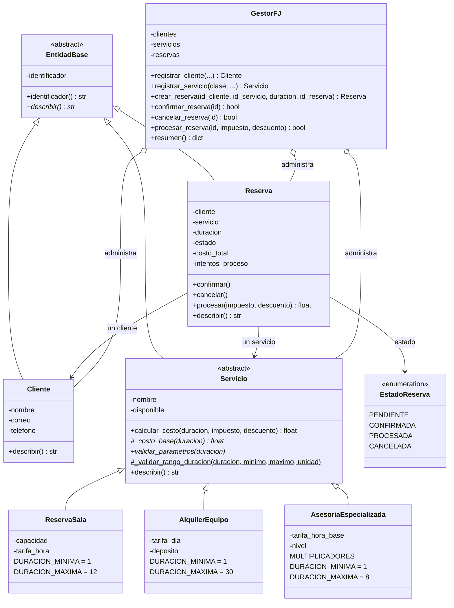
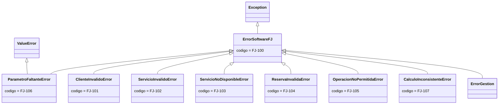
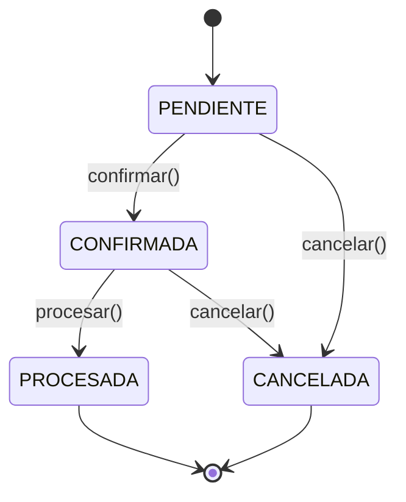

# Diagrama de clases - Software FJ

Este diagrama está escrito en Mermaid: GitHub lo dibuja automáticamente al abrir este archivo.
Para exportarlo como imagen o PDF (el informe final lo pide), se puede pegar el bloque en
<https://mermaid.live> y descargar el resultado.

## 1. Modelo de dominio

## 2. Jerarquía de excepciones

## 3. Estados de una reserva

